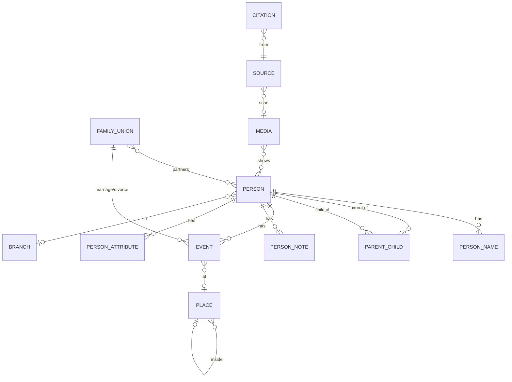

# Database Schema (ধাপ ৩)

SQLite (ব্রাউজারে WASM, অফলাইন)। ফাইল: `src/db/migrations/001_core.sql`। নতুন পরিবর্তন সবসময় নতুন migration ফাইলে (002, 003...), পুরোনোটি কখনো বদলানো হবে না।

## মূল নিয়ম (ডেটাবেস নিজেই বাধ্য করে)
- **আইডি:** প্রতি রেকর্ডে UUID, কখনো বদলায় না।
- **অজানা = NULL।** তারিখের qualifier `unknown` হলে বছর/মাস/দিন ফাঁকা থাকতেই হবে, অনুমান ঢোকানো যায় না।
- **আনুমানিক তারিখ:** `exact / about / before / after / between`, সঙ্গে মূল লেখা (`d_text`) ও ক্যালেন্ডার (গ্রেগরিয়ান/বঙ্গাব্দ/হিজরি)।
- **Status:** প্রতিটি তথ্যে `verified / unverified / estimated / unknown`।
- **উৎস:** `citation` টেবিল যেকোনো তথ্যকে `source`-এর সঙ্গে জোড়ে।
- **সম্পর্ক:** `parent_child.kind` = জৈবিক/দত্তক/সৎ/পালক/অভিভাবক/অজানা। একজন সন্তানের জৈবিক বাবা ১ জন, মা ১ জন, মোট ২ জনের বেশি নয়।
- **চক্র নিষেধ:** কেউ নিজের পূর্বপুরুষ হতে পারে না।
- **অজানা পূর্বপুরুষ:** `person.is_placeholder = 1`।
- **ডুপ্লিকেট:** `v_possible_duplicates` ভিউ একই নাম ও একই/অজানা জন্মসাল ধরে।
- **কখনো মোছা হয় না:** `deleted_at` বসে, হার্ড ডিলিট আটকানো।
- **History:** প্রতিটি যোগ/বদল/মোছা স্বয়ংক্রিয়ভাবে `change_log`-এ (আগে-পরে, কে, কখন)। এই টেবিল বদলানো বা মোছা যায় না।
- **নতুন ধরনের তথ্য:** `person_attribute` (key/value) দিয়ে স্কিমা না বদলেই।
